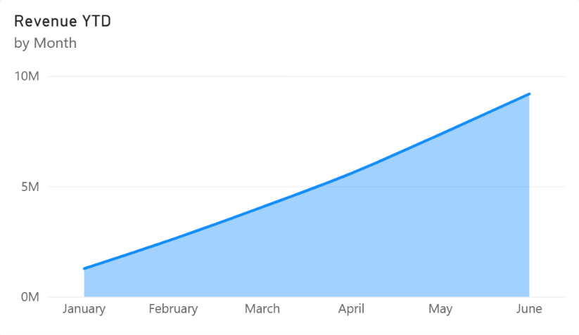
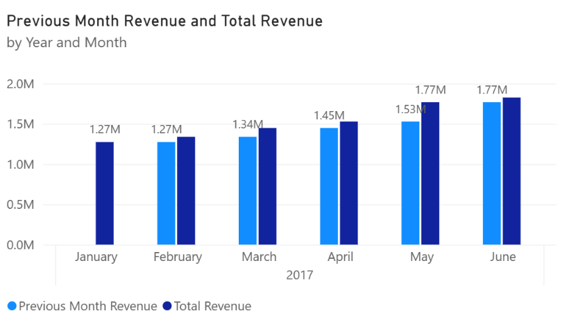
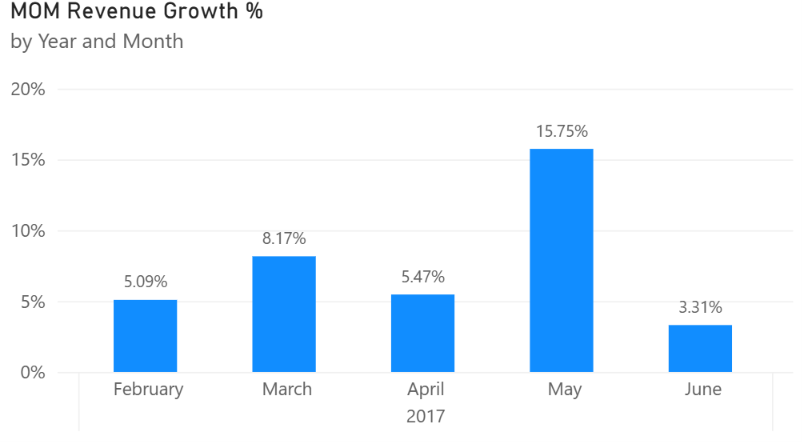
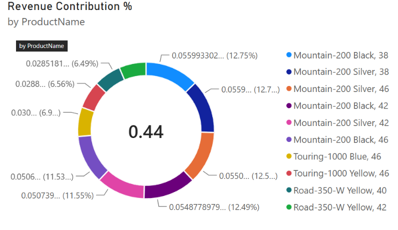
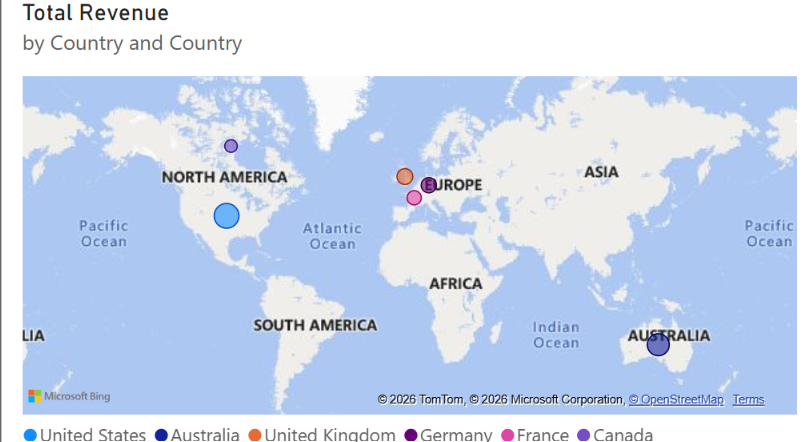

# AdventureWorks Sales Dashboard (Power BI)

An interactive Power BI report analysing AdventureWorks sales for January to June 2017:
revenue trends, month-over-month growth, product mix, profitability and geographic spread.

## Dashboard Preview

### Revenue YTD

### Total Revenue vs Previous Month Revenue

### Month-over-Month Revenue Growth %

### Top 10 Products by Revenue Contribution

### Revenue by Country

## Key Insights
- Revenue grew steadily every month, from about 1.27M in January to about 1.8M in June.
- Cumulative revenue (YTD) reached roughly 9M by the end of June.
- May had the strongest growth, at 15.75% over April. June growth slowed to 3.31%.
- The top 10 products (mainly Mountain-200 variants) account for about 44% of revenue.
- The United States is the largest market, followed by Australia, the UK, Germany, France and Canada.

## Key Questions Answered
- How is revenue building up through the year?
- How does each month compare with the previous month?
- Which products contribute most to revenue?
- Which countries generate the most revenue?
- Which subcategories and products are most profitable? (matrix: revenue, cost, profit)

## DAX Measures
`Total Revenue`, `Total Cost`, `Total Profit`, `Revenue YTD`,
`Previous Month Revenue`, `MOM Revenue Growth %`, `Revenue Contribution %`

## Data Model
- **Fact table:** `AdventureWorks_Sales_2017`
- **Dimensions:** `AdventureWorks_Calendar`, `AdventureWorks_Products`,
  `AdventureWorks_Product_Subcateg`, `AdventureWorks_Territories`

## Tools
Power BI Desktop, DAX, Power Query

## How to Open
Download `Powerbiproject.pbix` and open it in Power BI Desktop (free for Windows).

